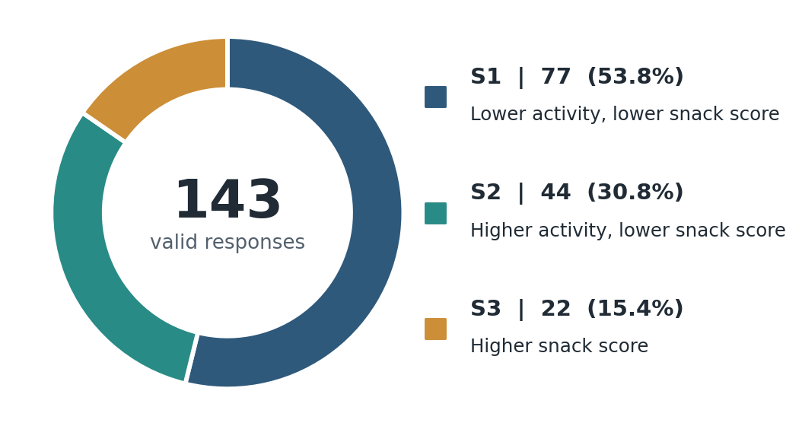
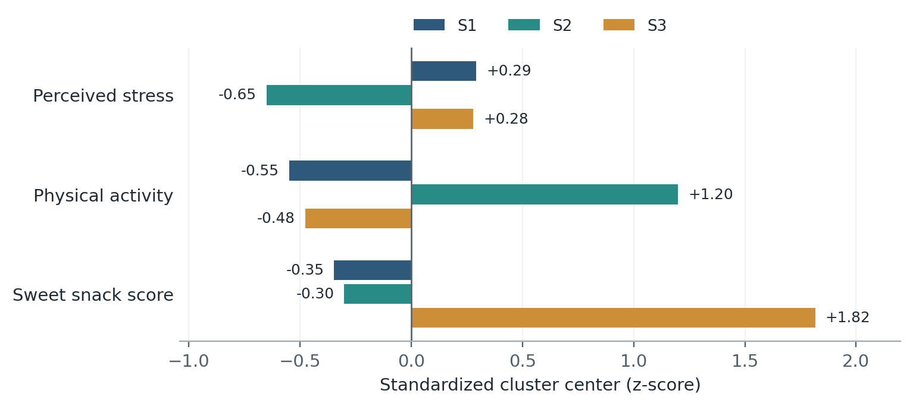
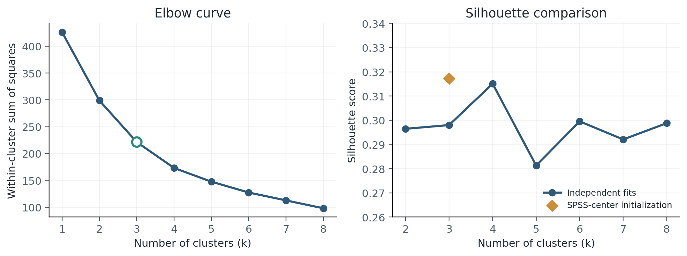
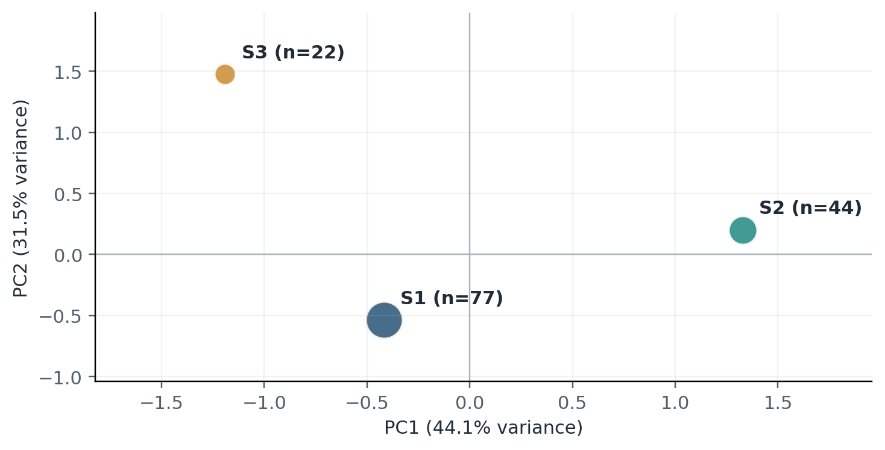
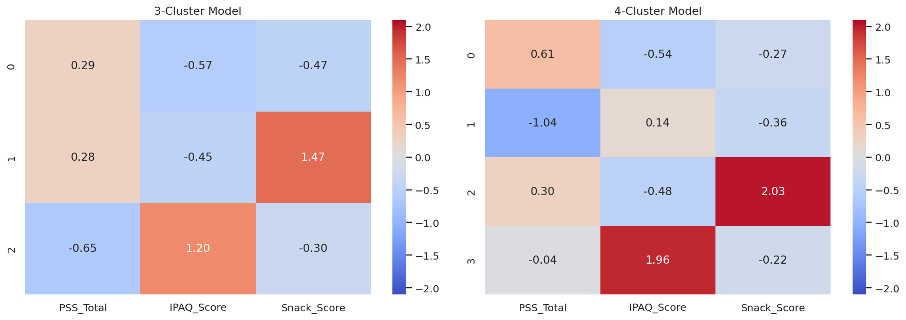
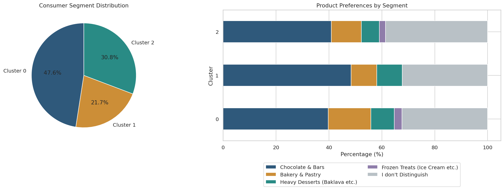

# Consumer Segmentation in the Sweet Snack Market

**Academic case study | Research Methodology, 2025–2026 fall semester**

## Business question

Can university students be grouped into meaningful consumer profiles using perceived stress, physical activity and sweet snack consumption behavior? What product and communication hypotheses could be tested using the resulting profiles?

## My contribution

This was an eight-person academic team project. I designed the full questionnaire, independently explored the SPSS analyses in Python, considered three and four clusters using the elbow method, and chose three based on interpretability and marketing differentiation (my recollection). I visualized results in Matplotlib and practiced Seaborn in preparatory work. I was one of three contributors to the marketing recommendations.

**2026 AI-assisted extension:** ChatGPT provided code blocks, explained the methods and helped interpret the outputs; I executed the cells, inspected the outputs, discussed the statistical and business trade-offs and corrected category labels. The uploaded completed notebook was rerun successfully. The included, privacy-conscious edition removes redundant cells, private previews and individual PCA points. Original preparatory notebooks (20 example customers and 200 simulated records) and the final pie-chart notebook were recovered; the original real-data Python clustering notebook and SPSS syntax have not been recovered. Raw responses are not distributed.

## Research workflow

1. Collected 153 online survey responses; excluded seven non-students and three extreme physical activity observations. Final sample: 143.
2. Used PSS-10 for perceived stress, IPAQ-based activity scores, and a snack score calculated as reported portion size × frequency.
3. The team checked PSS-10 internal consistency (Cronbach's alpha = 0.838), standardized the three variables using z-scores, and used hierarchical clustering followed by K-means.
4. I independently retested the analyses in Python and selected three clusters using the elbow method during the project. The original elbow curve is not available; the new portfolio audit below recreates a curve from the recovered workbook.
5. The team profiled clusters using cross-tabulations, descriptive statistics and ANOVA.

## Results



| Segment | n | Share of sample | Stress z | Activity z | Snack z |
|---|---:|---:|---:|---:|---:|
| S1 – Lower activity, lower snack score | 77 | 53.8% | +0.29 | -0.55 | -0.35 |
| S2 – Higher activity, lower snack score | 44 | 30.8% | -0.65 | +1.20 | -0.30 |
| S3 – Higher snack score | 22 | 15.4% | +0.28 | -0.48 | +1.82 |



**Main insight:** S1 and S3 have almost identical average standardized stress scores but very different snack scores. A single variable is therefore insufficient to describe the profiles observed in this sample. This is a descriptive comparison of variables used to create the clusters, not an independent test of a causal relationship.

Reproduced ANOVA results for the SPSS-center-initialized solution included age (p = 0.024), year of study (p = 0.044), gym frequency and team-sport frequency (both p < 0.001). Budget did not differ significantly (p = 0.966). These p-values are exploratory and unadjusted for multiple testing; pairwise differences and effect sizes should be evaluated before stronger claims are made.

## Reproducibility audit

A recovered workbook contained 146 rows and 34 columns (the report states 153 initial responses and seven ineligible participants had already been excluded). The seven excluded records were not available for independent review. There were no missing cells or duplicate responses. All 146 stored PSS-10, IPAQ and snack scores matched their reconstructed formulas. PSS-10 items 4, 5, 7 and 8 are reverse-coded.

Using the upper outer fence Q3 + 3 × IQR (6,728 MET-min/week) removed three activity outliers. The remaining 143 observations matched the report's maximum activity score (5,838) and Cronbach's alpha (0.838078). The report's example cutoff above 14,000 would not remove any observation from this workbook; the outer-fence rule is the reconstruction used here, not a confirmed original syntax setting.

### Model replication and selection

| Model | S1 | S2 | S3 | WCSS | Silhouette |
|---|---:|---:|---:|---:|---:|
| Original SPSS-center initialization | 77 | 44 | 22 | 221.689 | 0.3172 |
| Independent K-means, k=3, 50 starts, seed 42 | 68 | 44 | 31 | 221.435 | 0.2980 |

The reference-initialized fit reproduced the report's cluster counts and standardized centers to within 0.000005. Starting from the known centers demonstrates consistency with the reported solution, not independent proof that it is the unique optimal clustering. The independent fit had a slightly lower WCSS, but redistributed nine observations in aggregate between S1 and S3; adjusted Rand index (ARI) versus the reference fit was 0.832. Counts were aligned by nearest centroid.



The independent k=4 fit had the largest silhouette among k=2–8 (0.3151). The silhouette of the reference-initialized k=3 solution was 0.3172; this is an anchored reconstruction, not a fair independent model-selection contest. The elbow curve suggests diminishing returns but not a definitive optimum at three. Three clusters remain the primary exploratory model because they are interpretable, comparable with the original research, and more parsimonious; the smallest independent segment has n=31 versus n=18 in k=4. Model separation is modest and should not be overstated. The original choice of three also reflected the overlap in marketing ideas for the four-cluster solution, according to the participant. Sixty bootstrap resamples of the standardized data yielded median ARI 0.652 against the independent k=3 solution (10th–90th percentiles: 0.394–0.907), indicating sensitivity to resampling.



The first two principal components explain 75.6% of the variance. The plot shows only aggregate centroids, not individual survey records or evidence of complete cluster separation.

## Independent model profiles and product preferences



| Independent cluster | n | Stress z | Activity z | Snack z |
|---|---:|---:|---:|---:|
| C0 (closest to S1) | 68 | +0.294 | -0.572 | -0.473 |
| C1 (closest to S3) | 31 | +0.280 | -0.448 | +1.466 |
| C2 (closest to S2) | 44 | -0.651 | +1.200 | -0.302 |

Independent labels are distinct from the original SPSS labels. Spearman rho between stress and snack score was 0.056 (p=0.509); stress and activity rho=-0.295 (p=0.00035), activity and snack rho=-0.062 (p=0.462). The Kruskal–Wallis test for age yielded p=0.00989 and budget p=0.33060. These tests are exploratory; pairwise differences and causality are not established.



Original report p. 60 categories are retained: Chocolate & Bars, Bakery & Pastry, Heavy Desserts (Baklava etc.), Frozen Treats (Ice Cream etc.), and I don't Distinguish. All 15 rounded percentages from the reference-initialized model match the original chart. Independent model percentages differ because assignments differ, not because the data or category codes changed.

## From findings to marketing hypotheses

| Segment | Proposed experiment | What to monitor |
|---|---|---|
| S1 | Original multipack and assorted box concept: test an optional assortment versus a single item. | Choice, satisfaction, purchase intent |
| S2 | Original drinkable option: test a convenient beverage format against a standard snack format. | Product preference, perceived value |
| S3 | Original portion/pack concept: test variety and transparent pack information against the standard assortment. | Product preference, satisfaction |

These are adapted from the team’s original proposals, not observed sales results. The similar preference distributions support testing format rather than presuming separate product categories. No survey evidence establishes beverage preference, stress relief, price sensitivity or actual campaign lift. Original claims about stress relief, performance and increasing consumption are not retained. Avoid targeting perceived stress or other vulnerabilities, and avoid unsupported health or performance claims. Use transparent product information and respect consumer choice.

## Limitations and next steps

- Convenience sampling, a modest sample, a predominantly female and final-year sample, and self-reported cross-sectional data limit generalization and causal claims.
- Cluster numbers in the original recommendations section were inconsistent. This case study uses the cluster IDs and counts shown in the SPSS output (report page 17).
- The recovered dataset was audited privately; the original real-data Python clustering notebook and SPSS syntax/settings remain unavailable. No row-level responses, respondent IDs or individual cluster assignments are distributed.
- When the original notebook or SPSS syntax becomes available, compare its settings with this reconstruction. The new script documents scoring, model settings, effect sizes and exploratory stability results; further work should address experimental validation and multiple-testing controls.
- Before sharing externally, remove respondent identifiers and obtain any required authorization for the team material. Do not publish sensitive survey records. Only aggregate data are provided here.

## Reproduce the figures and model audit

The completed 2026 notebook is in `notebooks/Consumer_Segmentation_Analysis.ipynb`, with all 35 analysis cells and explanatory Markdown. Outputs are aggregate and were regenerated from the recovered workbook. To run, install requirements, place the authorized workbook beside the notebook or set the `SURVEY_WORKBOOK` environment variable to its private path, and restart/run all cells. Keep the workbook outside version control. A separate technical audit script adds model stability and report replication checks.

Install the chart dependencies in a virtual environment, then run:

```bash
python -m pip install -r requirements.txt
python src/visualize_summary.py
```

The first script redraws the two original-report summary charts without private data.

If authorized to access the private workbook, run the new audit script separately:

```bash
python src/reproduce_analysis.py /private/path/to/anket_cevaplari_153.xlsx
```

It verifies score formulas, reproduces the documented sample, fits K-means for k=1–8, reconstructs the reference solution from the SPSS centers, reports validation metrics and writes **only aggregate results and visuals**. The original notebook is not presented as recovered. Raw records are excluded from the portfolio. For consistent Python results, the audit used scikit-learn 1.8.0, seed 42 and 50 initializations (the separate reference fit uses one initialization).

## Files

- `notebooks/Consumer_Segmentation_Analysis.ipynb` — verified, AI-assisted analysis with aggregate outputs.
- `data/independent_*.csv`, `data/reference_product_preferences_pct.csv`, `data/cluster_transition_counts.csv`, `data/spearman_correlations.csv` — aggregate results.
- `case_study.pdf` — short recruiter-facing case study.
- `data/segment_summary.csv` — transcribed aggregate values from the original SPSS table.
- `src/visualize_summary.py` — companion script that redraws summary charts.
- `src/reproduce_analysis.py` — new Python audit; requires the private survey workbook.
- `data/model_metrics.csv`, `data/replication_comparison.csv`, `data/profile_anova.csv`, `data/validation_summary.json` — aggregate audit results.
- `figures/` — report summary charts and new model diagnostics.

**Source:** Academic team report, *Sugar Consumption*, Research Methodology course project, 2025–2026 fall semester, pp. 15–23 and 25–27. Individual Python and questionnaire contributions are described by the project participant. The report itself and individual records are not redistributed in this package.
